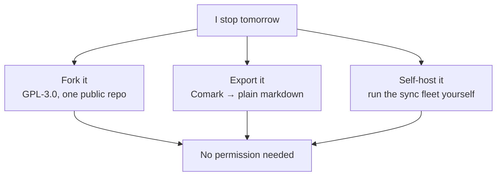

<!-- Frame: Announcement Day. -->
<!-- Markers: GATE | FACT | BRIDGE | QUARRY
  GATE   = licensed by a launch gate (see Notion gates table)
  FACT   = number/detail you must confirm
  BRIDGE = connective tissue in my words, not quarry — rewrite in yours if it grates
-->
<!--
  Changes from about.md:
  • "The bet" fully redrafted on YOUR two-axis taxonomy (quarry: your taxonomy message,
    near-verbatim in places) + the ratified additions (gradual typing, Goldilocks
    polymorphism, closeted databases, storage/interchange orthogonality, API-quality moat)
  • SQLite-35% citation stays dead
  • Storage + export prose DEMOTED to FAQ pointers → /docs/storage, /docs/export (FACT: targets must exist)
  • "How the code gets written" compressed to an FAQ entry → /docs/development
  • FAQ tail: interrogative headers, the cosplay wink, graduation mechanism
  • Sustainability: kept + Mermaid bus-factor flowchart (FACT: needs a mermaid renderer in Nuxt Content)
  Changes from why.v1 -> five corrections from your review (delete before deploy)
  1. Apple critique → the lock-in argument (your quarry, near-verbatim); dictatorship
     analogy PARKED: "historically they've always ended in violent revolutions" is a
     universal that fails your own fact-check rule (Spain, Portugal, the USSR's collapse,
     Taiwan, South Korea) — the loyalty-signal argument is stronger standing alone.
  2. Time-blindness restored to pure origin — the "pillar not plugin" framing was an
     answer without a question; deleted.
  3. Charts = Zod, not TypeScript — mechanism-matched (runtime validation, not erased
     annotations) and dodges the "why not TS all the way down" trap. NOTE: kept all
     TS-as-language dunking out — the extension API is TypeScript-facing; don't insult
     the audience you're recruiting.
  4. "Composition through Terrain edges" claim RETRACTED per your Rendezvous test —
     parent + children is what AnyType does too. Repaired to the defensible residue:
     the anti-stacking constraint + explicit AnyType adjacency, delta = epistemic.
  5. Your platform-API enumeration moved into the bet as the can't-be-plugins receipt.
  6. FAQ → Docus ::accordion / :::accordion-item syntax (verified against docus.dev).
  Changes from why.v2 -> ONE region changed for clean diffing — the bet's extension-API paragraphs:
  a. Moat + platform-API paragraph: unchanged through "someone else's plugin."
  b. NEW: the language-choice paragraph you approved in chat — TS surface with the
     constraint ledger attached (no binary modification on mobile, no downloaded
     native code, interpretation only inside a shipped runtime), dunk licensed
     by receipts. QUARRY: your arithmetic, near-verbatim.
  c. NEW: the WASM tier — non-UI plugins, write-in-whatever-compiles-to-it, Rust
     for yours, the Python/Julia analogy (QUARRY), small frozen ABI, not-yet by
     design. One sentence added beyond the approved draft (marked BRIDGE): the
     importer-goalpost-becomes-community-surface payoff. Strike freely.
  d. Old "designed, not shipped" closer folded into one sentence covering both tiers.

  LEDGER: /docs/extensions eventually owns the contract — two tiers, the frozen-ABI
  promise, and the iOS execution story (downloaded WASM runs interpreted or inside
  the webview's blessed engine; performance claims wait for numbers).
-->

## The origin

I'm organizationally chaotic — not messy, but not apparently organized either — and for years my research was spread across a dozen apps that each did one thing and refused to talk to the others. The cuts added up. Logseq's development timeline was inconsistent and its mobile API non-functional. Notion wouldn't let me catalog research papers and tasks in one place, and kept everything in someone else's always-online storage. Things only does tasks. Timing only does time. Obsidian's flat markdown files are supremely overrated — markdown should be how data enters and leaves a system, not how it lives inside one.
<!-- QUARRY: 2.1 + graveyard. Verify firing-line wording against your db rows. -->

And most of these tools are macOS and iOS only — vendor lock-in as architecture, not accident. Lock-in is a tell. When a business has to engineer switching costs to keep you, customer loyalty becomes untrustworthy: there's no way to determine whether people stay because the product is that good or because they haven't been pissed off enough yet. I wanted the opposite deal — a tool where leaving costs one export, so that staying means something.
<!-- QUARRY: your lock-in argument, near-verbatim. Final sentence is BRIDGE — the falsifiable-loyalty payoff; re-voice if it grates. Dictatorship analogy parked per v2 note. -->

The thing that finally made building viable wasn't a breaking point — it was agentic programming getting good enough to act as a multiplier for one person with about forty hours per five-week sprint.

And underneath all of it: time-blindness means I don't know how much time things actually take. When someone asks me to estimate the duration of something, I'm making up numbers. If I underestimate, I end up highly stressed and appear over-promising even when that's not my intention. It means not knowing how much time I spend working versus with friends and family or my dog. It means missing internal deadlines with my advisor, which sets back publications and jeopardizes PhD progression. No app was going to fix that by asking me to remember to start a timer.
<!-- QUARRY: 2.3 verbatim, pure origin — no pillar framing, no feature claims. -->

## The bet

"Everything is a block" is table stakes. Obsidian, Logseq, Tana, AnyType, and Craft all commit to it, and so does Waypoints — I just call them Marks. So blocks can't be the differentiator. What actually separates these tools is two axes the category keeps conflating: **where your data lives** (flat files ↔ a database) and **how typing works** (schema-free ↔ strict — with polymorphism as its own dial).
<!-- QUARRY: your taxonomy message. -->

Waypoints' cell is **gradual typing**. Schema-free by default — everything is at least a page — and typecast exactly as far as you want: as much type enforcement as you ask for, none you didn't. Charts are Zod for your notes, not TypeScript: runtime schemas you opt into, validating real data as it exists — not annotations erased before anything runs.
<!-- QUARRY: "typecast if someone wants it." Zod swap per your irony — mechanism-matched now. -->

On the polymorphism dial: Notion gives you none — a thing is a page, a block, or strictly typed inside a database silo, with no way for a page to gradually become typed. Tana takes polymorphism to a substantial extreme — SuperTags stack on a single object without bound. Waypoints holds the dial at exactly one Chart per Landmark, so "what is this?" always has a single answer. When something feels like it needs four types — a meeting with its recording, transcript, generated summary, action items, and your own notes, ideologically one unit — that's not one object wearing five SuperTags; it's several Landmarks and the structure between them. And honestly: structurally, that composition is what AnyType does too — a parent with typed children. The claim here isn't a mechanism AnyType lacks. It's that Waypoints' object model is documented well enough to explain in a paragraph, and the data can leave. Pre-Beacons, that epistemic difference _is_ the difference, and I'd rather say so than pretend otherwise.
<!-- QUARRY: your Rendezvous example + your AnyType-parity concession, near-verbatim. -->

The rest of the field, date-stamped: AppFlowy is marketed as an open-source Notion replica, which means it inherits Notion's problems on purpose. Obsidian and Logseq sit at files-times-folk-typing — schema enforcement is handcrafting templates, or recalling the exact structure and handwriting it in. And here's the part they never actually admit: both are closeted database apps. On every boot they build a database in RAM out of your files — DataScript, the metadata cache, Dataview's index — and then every plugin queries the database while none of them queries the files. Database costs, no database benefits: nothing durable, nothing transactional, full re-derivation at startup. Logseq's DB rewrite is the confession, in progress. Tana and AnyType — the two nearest neighbors — both neglect the leaving half: Tana's API was import-only and AnyType's export was protobuf, as of mid-2025 (corrections welcome). I'd define an export format as something that doesn't mandate vendor lock-in, which protobuf trivially does.
<!-- QUARRY: your competitor walk. FACT: re-verify AnyType export before deploy — if a markdown path now exists, re-aim at fidelity (types/relations not surviving); the definition line survives either way. -->

Which exposes the conflation the whole category runs on: **where data lives** versus **how data leaves**. Obsidian collapses the two on purpose — the file _is_ the interchange — buying legibility at the cost of structure. Tana and AnyType separate them and then abandon the leaving half. Waypoints separates them and takes both seriously: a database for living — because time series, calendar events, and document annotations don't work well as text files — and Comark for leaving. **Your data is yours, and the text can be read in 1980 or 2180** — that sentence is about the second axis, and only the second.

One more bet, borrowed from the only moat in this category that ever held: Obsidian's edge was never files — it was a usable API and the community that grew on it. An extension API's _presence_ predicts adoption; its _quality_ predicts retention. Logseq proves both halves at once: it gained users by supporting extensions and bleeds them because plugins layered out of iFrames that can't run on mobile barely count as an API at all. And some things can't be plugins under any API, because they need the platform itself: tracking which apps are open takes accessibility APIs on macOS, Windows, and Linux; health data takes HealthKit and HealthConnect; local speech and on-device models take CoreML, Metal, CUDA and friends — none of which a plugin sandbox can reach. That's the technical reason Waypoints is an app rather than someone else's plugin.
<!-- QUARRY: your API-ergonomics argument + platform-API enumeration. Unchanged from v2. -->

The extension API will be TypeScript, and not out of admiration — JavaScript is a language I'll dunk on happily, chosen with eyes open. The arithmetic: extensions must run everywhere Waypoints runs, including phones, and mobile platforms won't let an app modify its own binary or execute code it downloads later — the one tolerated escape hatch is interpretation inside a runtime the app already ships. Waypoints ships one: the entire frontend is TypeScript and Vue, and UI extensions bottom out in that layer no matter what language they start in. Purity had no candidate that survives an iPhone.
<!-- NEW in v3. QUARRY: your constraint ledger, near-verbatim from chat. -->

For plugins that aren't UI at all — importers, validators, transforms — a WASM tier is planned: write them in whatever compiles to it; I'll be writing mine in Rust. The first citizens of that tier are importers — pure data-in, data-out, no UI — which turns the importer goalpost from my backlog into surface anyone can build on. TypeScript is to WASM what Python is to Julia — the mature interface and the young thing that's better at the heavy lifting — and I'm resolving it the way computational people always have: the mature language stays the surface, the young one gets the work its strengths are undeniable for. Planned means planned: this tier ships behind a small frozen ABI, and not before. Both tiers are designed, not shipped — the runtime architecture and the MCP surface are the receipts today; the ecosystem claim waits until it's earned.
<!-- NEW in v3. QUARRY: your Python/Julia analogy + approved draft. BRIDGE: the importer-surface sentence — strike freely. LEDGER: /docs/extensions eventually owns this contract (two tiers, frozen-ABI promise, iOS execution story); WASM = not-yet, by design. -->

## How this outlives my motivation 

I can't make guarantees yet — this is a problem I'm acutely aware of. The steps I'm taking: the code is GPL-3.0, so improvements are either contributed upstream or downstream derivatives function as continuations of the project. The [data covenant](/covenant) is the benchmark for cutting v1 — pre-v1 breaking changes are still possible, but they will be very loud and come with a graceful degradation path so your data is not lost; post-v1, the data schema is highly durable and development moves to surfaces like the extension API and MCP. <!-- FACT: /covenant target. -->

There isn't a second maintainer. There is a design goal that there never needs to be one for your data to survive:

If you'd rather audit than wait, commit rights are earnable — things have been going well with agentic programming, but I'd like more humans working on this.
<!-- QUARRY: reply 2 + 3.e reply. -->

## Questions nobody has asked yet 

**Truthfully**: nobody has asked these. I made an AI cosplay a Hacker News commenter and answered its best objections. When real people ask better questions, these get replaced — answered [GitHub Discussions](https://github.com/waypoints-hq/waypoints/discussions) graduate in here, with the asker footnoted.

::accordion

:::accordion-item{label="Where does my data actually live?" icon="i-lucide-database"}
On your computer, in a Turso database with SQLite-incompatible features enabled — checked against a vanilla `tursodb` on every release so the experimental flags can't silently lock you in. The full storage story, `Database.open_with` included: [/docs/storage](/docs/storage).
<!-- QUARRY: 3.c compressed. FACT: doc must exist before deploy. -->

:::

:::accordion-item{label="If Waypoints dies tomorrow, what do I walk away with?" icon="i-lucide-door-open"}
A folder of Comark markdown — every Landmark a file, shared Marks duplicated exactly, assets content-addressed with links you can follow by hand. Projection rules and roundtrip tests: [/docs/export](/docs/export).
<!-- GATE: export shipped. FACT: doc target. -->

:::

:::accordion-item{label="What's rough right now?" icon="i-lucide-construction"}
Turso instead of battle-tested SQLite — beta exited at v0.7.0, experimental features on, vanilla-`tursodb` checked. Import is a continuously evolving feature set — the [migration matrix](/docs/import) is the source of truth, and task managers and calendars are a moving goalpost. Self-hosting the sync fleet works in principle and is untested in practice — today "cloud sync" is a Kubernetes cluster I manage, with encryption-at-rest enforced by the test suite. The covenant gates v1, so breaking changes remain on the table — loud, with graceful degradation. And one maintainer with an academic day job means some sprints go quiet.
<!-- QUARRY: 5.2 #1–#5 condensed. -->

:::

:::accordion-item{label="Who's actually writing the code?" icon="i-lucide-bot"}
Nearly every diff is AI-assisted and human-reviewed — saying "I wrote all the code" would be disingenuous, and the speed isn't because I'm superhuman. Agent commits land under a distinct identity, my merges are signed and branch-protected, feature-scale work starts from specs, and CI enforces the invariants. The full machinery: [/docs/development](/docs/development).
<!-- QUARRY: 1.5 + gates row. GATE: review machinery public. FACT: doc target. -->

:::

::
